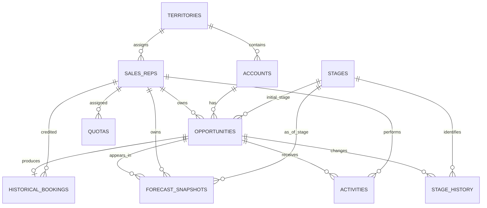

# Sales Forecasting Data Schema

## Overview

The YottaFlex synthetic revenue forecasting dataset contains ten relational tables.

The schema represents sales territories, representatives, accounts, opportunities, pipeline stages, stage transitions, activities, quotas, historical bookings, and forecast snapshots.

The model is designed to support:

- Revenue forecasting
- Historical pipeline reconstruction
- Sales performance analysis
- Booking reconciliation
- Data-quality validation
- Reproducible synthetic data generation

## Entity Relationship Diagram

## Core Tables

| Table | Primary key | Description |
|---|---|---|
| `territories` | `territory_id` | Sales territory reference data |
| `sales_reps` | `rep_id` | Sales representatives and territory assignments |
| `accounts` | `account_id` | Customer accounts and industries |
| `stages` | `stage_id` | Pipeline stages and baseline win probabilities |
| `opportunities` | `opportunity_id` | Sales opportunities and outcomes |
| `stage_history` | `stage_history_id` | Timestamped opportunity stage transitions |
| `activities` | `activity_id` | Sales interactions |
| `quotas` | `quota_id` | Quarterly sales targets |
| `historical_bookings` | `booking_id` | Realized won-deal bookings |
| `forecast_snapshots` | `forecast_id` | Historical opportunity-level forecast records |

## Relationships and Cardinality

### Territory relationships

- One territory can contain many sales representatives.
- One territory can contain many accounts.
- Each representative and account has one assigned territory in the current schema.

### Opportunity relationships

- One sales representative can own many opportunities.
- One account can have many opportunities.
- Each opportunity references one representative, one account, and one initial pipeline stage.

The opportunity's `stage_id` is the initially generated stage. The historical stage at a particular date is reconstructed from `stage_history`.

### Stage history

- One opportunity can have many stage-history records.
- Each stage-history record references one pipeline stage.
- Stage-history records include a timestamp and an ordered sequence.

The latest valid stage transition at or before an observation date determines the stage known at that time.

### Activities

- One opportunity can have many activities.
- One representative can perform many activities.
- Each activity references one opportunity and one representative.

The activity table functions as an event-level association between opportunities and representatives. It is not a separate opportunity-team membership bridge.

### Quotas

- One representative can have multiple quarterly quota records.
- Each quota is associated with a reporting quarter and currency.

### Historical bookings

- A won opportunity can produce a booking.
- Lost and open opportunities do not produce bookings.
- Each booking references an opportunity and the credited representative.

The generator currently creates at most one booking per won opportunity.

### Forecast snapshots

- One opportunity can appear in multiple historical snapshots.
- Each forecast record belongs to one snapshot date.
- A forecast record references the opportunity, its representative, and its stage as known at the snapshot date.

The intended business key is:

`(snapshot_date, opportunity_id)`

This prevents an opportunity from being counted twice in the same snapshot.

## Identifier Conventions

Identifiers are deterministic, consistently formatted strings.

Examples:

| Entity | Example |
|---|---|
| Representative | `REP-000001` |
| Account | `ACC-000001` |
| Opportunity | `OPP-2025-000001` |
| Stage-history event | `STG-OPP-2025-000001-001` |
| Quota | `QUOTA-REP-000001-2026Q1` |
| Forecast record | `FCST-2026-01-31-001` |

## Temporal Model

The schema distinguishes several important dates:

- `created_date`: when an opportunity enters the pipeline
- `expected_close_date`: the opportunity's expected closing date
- `actual_close_date`: the realized close date, if closed
- `changed_at`: when a pipeline stage transition occurred
- `activity_date`: when a sales activity occurred
- `booking_date`: when a won opportunity was booked
- `snapshot_date`: when a forecast observation was recorded

### As-of reconstruction

A forecast snapshot must not use stage changes or activities that occurred after its snapshot date.

The snapshot generator derives the opportunity's stage from eligible historical transitions and counts only activities known at the snapshot date.

### Effective dates and limitations

Stage-history events have explicit effective timestamps.

Territory assignments in the current implementation represent a single assignment per representative or account; there is no effective-dated territory-assignment history table.

Expected close dates are stored as current opportunity attributes rather than a versioned series of historical revisions.

These limitations should be considered when interpreting territory changes, slippage, and historical forecasting results.

## Integrity Constraints

The project validates:

- Primary-key uniqueness and non-nullness
- Foreign-key references across 15 relationships
- Expected close dates relative to creation dates
- Actual close dates relative to creation dates
- Booking dates relative to actual close dates
- Bookings associated with won opportunities
- Terminal stage consistency for closed opportunities
- Forecast arithmetic consistency
- Snapshot stage probabilities
- Snapshot-level duplicate opportunities
- Future-stage leakage
- USD baseline currency consistency

## Synthetic Data and Reproducibility

The dataset is generated using the fixed random seed `20261022`.

The full-scale configuration produces 2,000 representatives, 2,000 accounts, and 20,000 opportunities.

The generator writes ten CSV tables to `data/raw/`.

The SHA-256 manifest in `data/manifest.json` records row counts and file hashes. A repeated full-scale generation produced identical checksums for all ten CSV files.